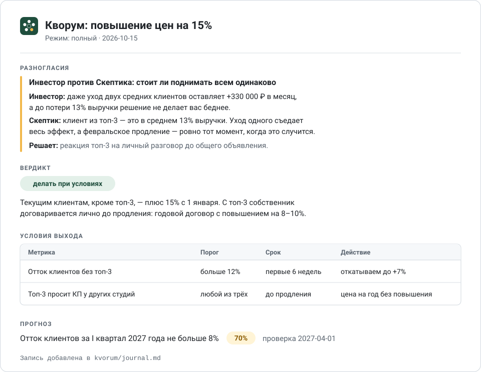

<p align="center"></p>

<h1 align="center">Кворум</h1>

<p align="center">Совет директоров для одного человека. Пять жёстких взглядов на твоё решение, пока оно ещё не стоило тебе денег.</p>

Обычный ИИ-ассистент склонен соглашаться. Кворум устроен так, чтобы спорить.

Большие решения обычно принимаются в одиночку или в кругу людей, которые не хотят тебя расстраивать. Кворум прогоняет решение через директоров с разными интересами и показывает, где они расходятся. Заседание заканчивается обязательствами: условиями выхода и прогнозом с датой проверки. Через квартал ретро покажет, кто был прав.

<p align="center"></p>

Подходит для решений вроде таких:

- поднять цены или поменять тарифы;
- нанять ключевого человека или расстаться с ним;
- запустить новое направление, открыть точку, выйти в другой город;
- сменить поставщика, сделать крупную закупку;
- уйти из найма в свой проект.

## Установка

**Без терминала.** В Claude Code или Claude Desktop отправь Claude сообщение:

```
Установи скиллы из https://github.com/shardnessS/kvorum
```

Claude сам скачает оба скилла и положит их куда нужно. В claude.ai так не получится: там скиллы загружают вручную, смотри следующий пункт.

**Claude.ai.** Скачай [kvorum.zip](https://github.com/shardnessS/kvorum/releases/latest/download/kvorum.zip) и [kvorum-retro.zip](https://github.com/shardnessS/kvorum/releases/latest/download/kvorum-retro.zip) и загрузи оба в разделе Skills настроек Claude.

**Claude Code, плагином**

```
/plugin marketplace add shardnessS/kvorum
/plugin install kvorum@kvorum
```

**Через npx skills** — для Claude Code, Cursor, Codex и других агентов:

```bash
npx skills add shardnessS/kvorum -g
```

С `-g` скиллы ставятся для всех проектов, без него — только в текущий.

**Вручную.** Скопируй папки из `skills/` в `~/.claude/skills/`.

## Пример

**Ты:**

> Собери кворум. Хочу с января поднять цены на 15% для всех клиентов.

**Кворум** сначала уточняет:

> 1. Сколько клиентов и какую долю выручки дают топ-3?
> 2. Когда цены поднимались последний раз?
> 3. Что делают с ценами конкуренты?
> 4. Зачем повышение: покрыть рост затрат или растить маржу?
> 5. Что будет, если не поднимать?

Затем выступают директора, а Секретарь сводит протокол: разногласия, вердикт, условия выхода и прогноз — как на картинке выше. Последним идёт первый шаг на ближайшие 48 часов: «Назначить встречи топ-3 клиентам до 17 октября».

Полный протокол этого заседания — [examples/protocol-prices.md](examples/protocol-prices.md).

## Что внутри

| Скилл | Что делает |
|---|---|
| `kvorum` | Заседание: уточняющие вопросы, выступления директоров, разногласия, вердикт, условия выхода, прогноз и запись в журнал |
| `kvorum-retro` | Ретро: сверяет прогноз с фактом, отмечает, чьи ставки сбылись, считает калибровку и счёт директоров |

## Как пользоваться

- «Собери кворум: …» — полное заседание
- «Быстрый кворум: …» — Скептик и Оппонент
- «Ретро по решению …» — проверка прогноза из журнала
- «Что пора проверить?» — решения, у которых наступила дата проверки
- «Калибровка» — насколько сбываются твои прогнозы и кто из совета чаще прав

## Состав совета

| Роль | Главный вопрос | Что делает |
|---|---|---|
| Скептик | «Почему это провалится?» | Pre-mortem: представляет, что через год всё провалилось, и восстанавливает три причины, у каждой ранний сигнал и страховка |
| Оппонент | «А если ты неправ?» | Находит допущение, на котором держится решение, строит сильнейший аргумент против и предлагает альтернативу, которую ты не рассматривал |
| Инвестор | «Это лучшее, куда можно вложить ресурсы?» | Полная стоимость, окупаемость в базовом и плохом сценарии, упущенная выгода, обратимость |
| Операционщик | «Кто это будет делать во вторник утром?» | Люди и их часы, план на 30 дней, узкое место, что придётся перестать делать |
| Секретарь | — | Ведёт протокол, формулирует вердикт, условия выхода и прогноз, пишет запись в журнал |

Каждый директор заканчивает выступление **ставкой** — одним проверяемым утверждением. Ставки попадают в журнал, и ретро отмечает, чьи сбылись.

## Как проходит заседание

1. **Повестка.** Ты описываешь решение своими словами. Если в проекте уже есть журнал, Кворум напомнит о прогнозах, которые пора проверить.
2. **Уточнение.** Совет задаёт 3–5 вопросов из справочника для твоего типа решения: цены, найм, запуск, закупка и другие. Без ответов заседание не начинается. Скажешь «без вопросов» — совет запишет допущения и будет считать их слабым местом.
3. **Выступления.** Каждый директор выступает отдельно и не подстраивается под остальных. В Claude Code директора работают как отдельные субагенты и не видят речей друг друга.
4. **Разногласия.** Кто с кем спорит, почему прав каждый и какая цифра решит спор. Обычно это самая ценная часть.
5. **Вердикт.** Делать, не делать, делать при условиях или отложить до выяснения конкретного факта.
6. **Условия выхода** и сигнал разгона.
7. **Первый шаг** на ближайшие 48 часов.
8. **Прогноз** с вероятностью и датой проверки уходит в журнал.

## Режимы

| Режим | Кто участвует | Когда использовать |
|---|---|---|
| Быстрый | Скептик и Оппонент | Решение среднего масштаба, которое легко отменить |
| Полное заседание | Все пять ролей | Крупное или трудно обратимое решение |
| Ретро | Скилл `kvorum-retro` | Наступила дата проверки |

## Условия выхода

Самое недооценённое в принятии решений — заранее договориться с собой, когда остановиться. Пока проект идёт, сложно признать, что он не работает: уже вложены деньги, время, репутация.

Поэтому вердикт Кворума всегда содержит условия выхода — конкретные, измеримые, с датой:

> Если за 8 недель меньше 30 заявок из нового канала — сворачиваем и возвращаем бюджет в контекстную рекламу.

Рядом стоит **сигнал разгона**: условие, при котором стоит вложиться сильнее. Чтобы удачное решение не осталось сделанным наполовину.

## Журнал и ретро

Каждое заседание оставляет запись в `kvorum/journal.md` в твоём проекте. Если у Claude нет доступа к файлам, Кворум выдаст запись для копирования.

```markdown
## 2026-10-15 · Поднять цены на 15%
- Тип: цены
- Вердикт: делать при условиях
- Прогноз: отток клиентов за I квартал 2027 года не больше 8%
- Уверенность: 70%
- Дата проверки: 2027-04-01
- Условия выхода: отток текущих клиентов без топ-3 больше 12% за первые 6 недель → откатываем повышение до +7%
- Ставка Скептика: один из двух клиентов топ-3 с февральским продлением запросит альтернативные предложения до 1 февраля
- Ставка Инвестора: выручка за I квартал 2027 года вырастет минимум на 8% к IV кварталу 2026
- Итог: —
```

Запись короче настоящей: полный формат — в [протоколе](examples/protocol-prices.md).

Когда наступает дата проверки, скажи «ретро по решению о ценах». Ретро сверит прогноз с фактом, отметит, чьи ставки сбылись, и сформулирует урок. Если условие выхода сработало, а ты не остановился, ретро скажет об этом прямо.

Через 10+ ретро становится видна **калибровка**: сбываются ли твои «70% уверен» в 70% случаев. Так выглядит она на [примере журнала](examples/journal.md) владельца веб-студии за год:

```
Калибровка
  Уверенность  Решений  Средняя  Сбылось  Вывод
  50–60%       2        58%      25%      мало данных
  65–75%       5        71%      60%      переоцениваешь себя
  80–95%       4        88%      88%      точно

Brier: 0.17 (0 — идеально, 0.25 — как монетка)

Совет директоров
  Директор      Ставок  да  частично  нет  Счёт
  Скептик       11      5   2         4    55%
  Оппонент      4       1   0         3    25%
  Инвестор      6       3   2         1    67%
  Операционщик  6       5   0         1    83%

Чаще всех прав по типам
  запуск: 100% — Скептик (2), Операционщик (2)
  цены: 100% — Инвестор (2), Операционщик (2)
```

Отсюда видно: в решениях с уверенностью около 70% владелец переоценивает себя, оба запуска новых направлений провалились, и в запусках стоило слушать Скептика.

Журнал хранится отдельно от скилла, в твоём проекте. Скилл — это инструкция, а не хранилище.

## Принципы

- **Без лести.** Директор, который полностью согласен с автором решения, обязан объяснить, почему не нашёл ни одного риска.
- **Независимость.** Роли не договариваются между собой заранее и не сглаживают углы.
- **Разногласия важнее консенсуса.** Если все согласны — скорее всего, кто-то плохо искал.
- **Нет вердикта без условий выхода.**
- **Решение принимает человек.** Кворум даёт взгляды, аргументы и структуру, а не приказы.

## Чего Кворум не делает

- Не заменяет юриста, бухгалтера и финансового консультанта. Когда решение упирается в закон, налоги или договор, директор назовёт, что именно проверить у специалиста.
- Не знает твой рынок лучше тебя: качество заседания зависит от вводных.
- Не принимает решение за тебя.

## Файлы

```
skills/kvorum/
  SKILL.md                      порядок заседания, режимы, правило «без лести»
  roles/                        пять ролей: как думает и в каком формате говорит каждая
  references/questions.md       уточняющие вопросы по типам решений
  templates/                    формат протокола и записи в журнал
skills/kvorum-retro/
  SKILL.md                      ретро, что пора проверить, калибровка
  scripts/journal.py            подсчёты по журналу, только стандартный Python
  references/journal-format.md  формат журнала и определения
  templates/retro.md            формат ретро
examples/journal.md             пример журнала за год
examples/protocol-prices.md     пример полного протокола заседания
evals/                          тест-кейсы для claude plugin eval
tests/                          тесты journal.py
assets/                         иконка и картинка протокола
```

## Проверка

В `evals/` четыре тест-кейса для `claude plugin eval`: полное заседание с записью в журнал, пустые вводные (совет обязан сначала спросить), быстрый режим и ретро с известным исходом. Каждый кейс прогоняется с плагином и без него, разница показывает, что добавляет Кворум.

```
claude plugin eval . --allow-tools Write Edit --runs 1 --trust-plugin --no-publish
```

Скрипт журнала покрыт тестами: `python -m unittest discover -s tests -v`.

## Автор

[shardness](https://github.com/shardnessS) · Лицензия MIT
